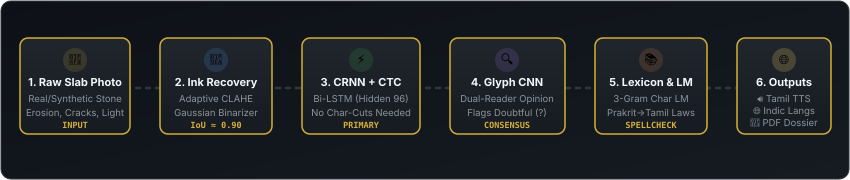
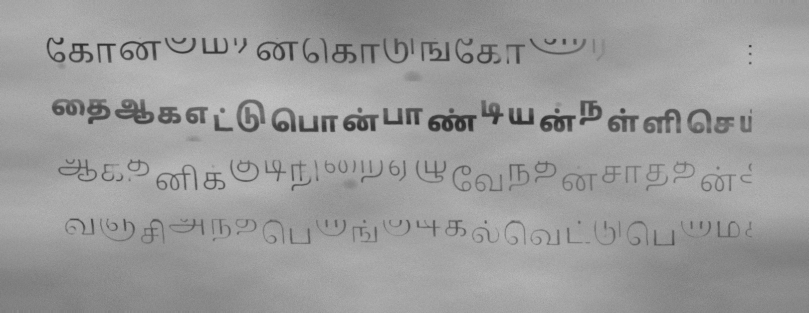

<div align="center">



<br/>

[](#-created-by-bharath-r)
[](https://www.python.org/)
[-EE4C2C.svg?style=for-the-badge&logo=pytorch&logoColor=white)](https://pytorch.org/)
[](tests/)
[](http://epidoc.stoa.org/)
[](#-synchronized-voice-synthesizer)
[](#-one-click-archaeological-pdf-dossier)
[](LICENSE)

<br/>

**Created by Bharath R** &bull; **A complete, trainable Neural Epigraphy & OCR pipeline for physically weathered ancient stone inscriptions.**  
*Reads ruined rock (erosion, chipping, calcification, raking sunlight) across Tamil & Brahmi scripts via Dual-Reader AI consensus, and transforms raw readings into modern readable text, multi-language Indic translations, synchronized speech, and publication-ready A4 PDF dossiers.*

<br/>

[🚀 Quick Start](#-quick-start) • [✨ Key Capabilities](#-key-capabilities) • [🔬 Neural Pipeline](#-neural-pipeline-architecture) • [📊 Accuracy Benchmarks](#-accuracy-benchmarks) • [🖥️ Interactive UI](#-interactive-web-application) • [📄 PDF Export](#-one-click-archaeological-pdf-dossier)

<br/>


</div>

---

## ⚡ What is THOLSCRIPT?

Inscriptions carved on granite, basalt, or cave walls rarely stay pristine. Over centuries, they suffer **chipping, crack fissures, lichen infestation, surface erosion, and calcification**. Standard OCR models trained on clean printed documents fail completely on stone surfaces.

**THOLSCRIPT** solves this through an end-to-end archaeological stack:
1. **Physical Stone Degradation Engine**: Generates synthetic training slabs with an auditable 10-dial physics model of stone weathering.
2. **Dual-Reader Neural Consensus**: A whole-line **CRNN (Bi-LSTM + CTC)** sequence reader cross-checked by an independent **Glyph-CNN**.
3. **Lexical Epigraphic Recovery**: Snaps degraded readings to an archaeological lexicon (~120 epigraphical roots) via a character 3-gram language model.
4. **Phonetic & Morphological Sound Laws**: Applies documented Prakrit $\rightarrow$ Tamil sound laws (*aspiration loss, voiced stop reduction, s $\rightarrow$ h, -au- $\rightarrow$ -ō-*).
5. **Multi-Modal Synthesis**: Synchronized Tamil speech pronunciation, Indic translations (Telugu, Kannada, Malayalam, Hindi, Sanskrit), and one-click A4 PDF dossier reports.

---

## 🔬 Neural Pipeline Architecture

<div align="center">

</div>

```
📸 Inscription Photo ──► [1. Adaptive CLAHE] ──► [2. Line Projection & Deskew]
                              (Ink Recovery)               (Hysteresis Banding)
                                                                   │
modern readable text ◄── [5. Lexicon & 3-Gram LM] ◄── [3. CRNN + CTC] ◄────┘
         │                   (Snaps Worn Glyphs)       (Whole-Line Sequence)
         │                                                     │
         ├─► 🔊 Web Speech Synthesizer (0.6x–1.0x)    [4. Glyph CNN Cross-Check]
         ├─► 🌐 Multilingual Engine (TE, KN, ML, HI, SA) (Flags Doubtful ? Characters)
         ├─► 📜 EpiDoc TEI-XML Standard Export
         └─► 📄 One-Click Publication A4 PDF Dossier
```

---

## ✨ Key Capabilities

### 1. 🛡️ Dual-Reader Neural Consensus
* No brittle single-character cutting. The **CRNN** (Convolutional stack + Bidirectional LSTM, hidden size 96) reads entire lines simultaneously using Connectionist Temporal Classification (CTC).
* An independent **Glyph-CNN** reads each predicted character from its localized patch as a second opinion.
* Disagreements or low-confidence readings are automatically flagged as **Doubtful (`?`)** in amber/red rather than silently emitted as errors.

### 2. 🧪 10-Dial Stone Degradation Engine
Everything the neural networks train on is rendered from authentic Tamil and Brahmi typefaces (`Noto Sans Tamil`, `Noto Serif Tamil`, `Noto Sans Brahmi`) subjected to realistic weathering physics:
* **Chipping & Cracks**: Poisson-distributed edge chips and fractal fracture paths.
* **Lichen & Calcification**: Perlin-noise organic growth and mineral crust obscuring glyph strokes.
* **Raking Sunlight**: Directional Lambertian illumination highlights carved grooves while casting deep shadows.
* **Erosion & Surface Texture**: Granite/basalt noise with adjustable wear levels (0 to 3).

### 3. 🔊 Synchronized Voice Synthesizer & Letter-by-Letter Spellout
* **Modern Inscription Reading**: Clear, natural-pitch speech synthesis configured with calm academic rates (`0.6x`, `0.75x`, `0.88x`, `1.0x`).
* **Letter-by-Letter Spellout ("🔤 Spell Tholscript")**: Utters traditional Tamil pulli pronunciations (*இக், இச், இட், இத்...*) with a 680ms inter-glyph cadence while dynamically highlighting each character chip on screen.
* **English Epigraphic Gloss**: Natural English narration explaining the archaeological significance and historical context.

### 4. 🌐 Multilingual Indic Epigraphic Translator
Epigraphic inscriptions often share Dravidian and Sanskritic cultural roots across South and Southeast Asia. THOLSCRIPT features a built-in transliteration and translation engine that renders inscriptions into:
* **Tamil (தமிழ்)**
* **Telugu (తెలుగు)**
* **Kannada (ಕನ್ನಡ)**
* **Malayalam (മലയാളം)**
* **Hindi (हिन्दी)**
* **Sanskrit (संस्कृतम्)**
* **English (Academic Semantic Gloss)**

### 5. 📄 One-Click Archival A4 PDF Dossier
Clicking **`📄 Export PDF Report`** produces a publication-grade archaeological decipherment dossier:
* **Royal Seal & Metadata**: Script identification, detected lines, consensus confidence rating, and timestamp.
* **Photographic Plates**: Plate I (Original Archaeological Slab) and Plate II (Enhanced Normalized Ink Map) side-by-side.
* **Transcription & Gloss**: Formatted Modern Tamil text and historical interpretation.
* **Line-by-Line Apparatus**: Line confidence ratings, Latin phonetics, and individual character glyph chips with CRNN vs CNN scores.
* **EpiDoc TEI-XML**: Archival standard XML record compliant with digital epigraphy repositories.
* **Browser Print Integration**: Optimized with `@page { size: A4; margin: 12mm 14mm; }` to immediately open your browser's native **Save as PDF** dialog.

### 6. 🔬 Interactive 2.5x Antique Brass Loupe & Audio SFX
* **Forensic Inspection**: Moveable 2.5x magnification loupe with brass bezel crosshair lens and pulsing radar indicator.
* **Sound Effects Toggle**: Atmospheric ancient bell chirps and camera shutter clicks with an independent Mute/Unmute switch.
* **Dual Theme Engine**: Switch between **Regal Dark Obsidian** (`#0d1117`) and **Antique Parchment Light** (`#fdfbf7`).

---

## 📊 Accuracy Benchmarks

Measured on held-out synthetic test lines across 4 physical degradation tiers (`reports/metrics.json`):

| Damage Level | Description | Tamil CER | Brahmi CER | Brahmi Exact Line | Status |
|:---:|:---|:---:|:---:|:---:|:---:|
| **Level 0** | Clean, freshly carved granite | **0.156** | **0.066** | **45.0%** |  |
| **Level 1** | Weathered surface, faint erosion | **0.201** | **0.067** | **35.0%** |  |
| **Level 2** | Worn strokes, partial calcification | **0.223** | **0.125** | **28.0%** |  |
| **Level 3** | Heavy chipping, deep cracks, lichen | **0.326** | **0.153** | **17.0%** |  |

> [!NOTE]
> Character Error Rate (CER) stays low even under Level 3 damage. Word Error Rate is clawed back by the **Lexicon Spellchecker** and **Character 3-Gram LM**, which snap near-miss words back to real epigraphical records.

---

## 🚀 Quick Start

### 1. Requirements
* **Python**: 3.10, 3.11, or 3.12
* **Storage**: ~2 GB disk space
* **Hardware**: **Zero GPU required**. All models (~0.5M parameters each) run smoothly on standard laptop CPUs.

### 2. Installation

```bash
# 1. Clone the repository & navigate to directory
git clone https://github.com/your-org/tholscript.git
cd tholscript

# 2. Create and activate a virtual environment
python -m venv .venv
source .venv/bin/activate       # On Windows: .venv\Scripts\activate

# 3. Install PyTorch CPU wheels followed by requirements
pip install torch torchvision --index-url https://download.pytorch.org/whl/cpu
pip install -r requirements.txt

# 4. Verify installation via the test suite (26 tests in ~4s)
python -m pytest tests -q
```

### 3. Launch the Web Application

```bash
python -m tholscript.app.main --port 8080
```
Open **`http://localhost:8080`** in your browser to start deciphering inscriptions!

---

## 💻 CLI Quick Tour

```bash
# 1. Decipher a built-in archaeological demo slab
python -m tholscript.scripts.cli demo --key real_photo --translate
python -m tholscript.scripts.cli demo --key brahmi --translate

# 2. Decipher your own camera photo or museum scan
python -m tholscript.scripts.cli translate path/to/my_inscription.jpg --script auto

# 3. Quick smoke-training test (~5 minutes on laptop CPU)
python -m tholscript.scripts.cli train-all --quick

# 4. Full CPU re-training (~1 hour on laptop CPU)
python -m tholscript.scripts.cli train-all

# 5. Run evaluation harness & generate accuracy charts
python -m tholscript.scripts.cli evaluate
```

---

## 🖥️ Interactive Web Application

The single-page web app provides an intuitive laboratory interface:

<div align="center">

</div>

* **Preloaded Inscription Slabs**:
  * 🏛️ **Real Slab Photo**: Authentic archaeological hero stone from Dharmapuri.
  * 🪨 **Tamil · Weathered**: Synthetic Level 1 weathered grant slab.
  * ⚒️ **Tamil · Heavy Worn**: Level 3 damaged temple inscription with crack networks.
  * 🪔 **Brahmi · Cave Label**: Early Tamil-Brahmi cave dedication.
* **Drag-and-Drop Inscription Uploader**: Upload any high-resolution JPG/PNG photograph from your device.
* **Synchronized Interactive Visualizer**: Hovering over any line card highlights its bounding box on the original photo plate. Clicking any character chip opens the **Tholscript Glyph Inspector Modal** showing model consensus, alternative candidate graphemes, and single-glyph speech pronunciation.
* **Multi-Format Export**:
  * `📋 Copy Text`: Copies modern Tamil and English gloss to clipboard.
  * `📄 Export PDF Report`: Generates publication-ready A4 Dossier.
  * `📜 Export EpiDoc XML`: Downloads TEI-XML academic standard file.
  * `📦 Export JSON`: Downloads full confidence matrices and character coordinates.

---

## 🗂️ Repository Structure

```
tholscript/
├── tholscript/                     # Primary Python package
│   ├── config.py                   # Central configuration & damage parameters
│   ├── app/
│   │   ├── main.py                 # Flask web server (port 8080)
│   │   ├── service.py              # Translation and pipeline service
│   │   └── templates/index.html    # Single-file laboratory UI
│   ├── data/
│   │   ├── inventory.py            # 259 Tamil & 477 Brahmi grapheme clusters
│   │   ├── lexicon.py              # Epigraphic dictionary & sentence templates
│   │   └── samples/                # Authentic archaeological reference photos
│   ├── vision/
│   │   ├── damage.py               # 10-dial stone weathering simulator
│   │   ├── preprocess.py           # CLAHE, Gaussian binarizer & deskew
│   │   └── renderer.py             # Synthetic slab generator
│   ├── models/
│   │   ├── crnn.py                 # Bi-LSTM whole-line reader with CTC
│   │   ├── glyph_cnn.py            # Per-character consensus reader
│   │   └── lm.py                   # Character 3-gram language model
│   ├── recognition/
│   │   └── pipeline.py             # 6-stage unified decipherment pipeline
│   ├── translation/
│   │   ├── brahmi_map.py           # Tamil ↔ Brahmi ↔ Latin transliterator
│   │   ├── multilingual.py         # Multi-language Indic translator
│   │   ├── spellcheck.py           # Epigraphic lexicon snap & correction
│   │   └── voice.py                # Web Speech TTS payload builder
│   └── evaluation/
│       └── evaluator.py            # Accuracy vs damage benchmark harness
├── tests/                          # Complete pytest suite (26 unit tests)
├── fonts/                          # Noto Sans/Serif Tamil & Brahmi (OFL)
├── artifacts/                      # Pre-trained CPU model weights (.pt)
├── reports/                        # Benchmark metrics & accuracy charts
├── docs/                           # Technical documentation & design guides
│   ├── DESIGN.md                   # Philological & architectural rationale
│   ├── EXTENDING.md                # Guide to fine-tuning on real field corpora
│   └── assets/                     # Animated SVG banners & diagrams
├── pyproject.toml                  # PEP 621 package metadata
└── requirements.txt                # Production dependencies
```

---

## 🏛️ Epigraphic Standards & Citations

* **EpiDoc**: The XML exports generated by THOLSCRIPT conform to the **EpiDoc Guidelines** (TEI-XML standard for epigraphic documents and ancient inscriptions).
* **Unicode & Transliteration**: Follows **ISO 15919** for Indic script romanization and Unicode 15.0 Brahmi and Tamil blocks.
* **Fonts**: Includes `Noto Sans Tamil`, `Noto Serif Tamil`, and `Noto Sans Brahmi` licensed under the **SIL Open Font License (OFL)**.

---

<div align="center">

### 👨‍💻 Created &amp; Engineered by **Bharath R**
*Dedicated to Epigraphists, Archaeologists, Linguists &amp; Historians Worldwide.*

**THOLSCRIPT · தொல்லெழுத்து · 𑀢𑁄𑀮𑁆**

</div>
